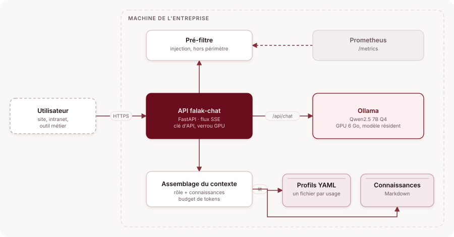

# Falak Chat

**Un assistant IA qui tourne sur l'ordinateur de l'entreprise, et qu'on adapte à chaque métier sans le réentraîner.**

La plupart des entreprises qui veulent un assistant IA se heurtent à la même
question : peut-on envoyer nos données chez OpenAI ou Google ? Ce projet montre
qu'on n'est pas obligé. Le modèle (Qwen 2.5, open source) tourne sur une carte
graphique ordinaire de 6 Go, et aucune conversation ne quitte la machine.

C'est le moteur de l'assistant que vous pouvez essayer sur
[falakion.com/falak](https://falakion.com/fr/falak).



## Un modèle, plusieurs métiers

Le même modèle joue des rôles très différents selon le **profil** qu'on lui
donne. Pour la démonstration, j'ai imaginé une PME de transport, Transports
Delorme, et quatre usages :

| Profil | À quoi il sert | Ce qu'il ne fera jamais |
|---|---|---|
| Service client | répondre sur les délais et les réclamations | inventer le statut d'un colis qu'il ne connaît pas |
| Assistant RH | répondre aux salariés sur les congés, le télétravail, les frais | parler du salaire d'une personne |
| Rédaction commerciale | transformer des notes en brouillon d'e-mail | inventer un prix ou un numéro de téléphone |
| Tri des tickets | classer un message client et en extraire les infos | renvoyer autre chose qu'un JSON valide |

Un cinquième profil, `falakion`, est l'assistant public de mon site.

Un exemple avec le tri des tickets :

```
« URGENT : 3 cartons de yaourts écrasés à la livraison ce matin, récépissé 5520019944. »

{"categorie": "avarie", "urgence": "haute", "recepisse": "5520019944",
 "resume": "Trois cartons de yaourts écrasés à la livraison"}
```

Ce résultat peut aller directement dans un outil de ticketing.

## Comment on personnalise un modèle sans le réentraîner

Un profil est un simple fichier texte (YAML) qui décrit :

- **le rôle** : ton, périmètre, ce qu'il doit refuser ;
- **les connaissances** : les règles de l'entreprise, injectées à chaque question ;
- **les réglages** : plus ou moins de créativité, longueur des réponses ;
- **le format de sortie** si besoin : un schéma JSON que le modèle est obligé de respecter.

Ajouter un nouvel usage, c'est ajouter un fichier. Quand ça ne suffit plus
(vocabulaire très spécifique, style maison), le dossier `finetune/` permet
d'entraîner un petit adaptateur LoRA sur de vrais échanges.

## Ce que j'ai appris en production

**La fenêtre de contexte peut faire mentir le modèle sans prévenir.** Quand le
texte envoyé dépasse la mémoire du modèle, Ollama coupe le *début* sans aucune
erreur, c'est-à-dire là où se trouvent les faits sur l'entreprise. Mon assistant
public inventait le nom du fondateur, tout en refusant correctement les
questions hors sujet. Depuis, chaque profil est vérifié au démarrage et en
intégration continue, et `falak check` mesure la taille exacte avec le
tokenizer du modèle.

**On ne corrige bien que ce qu'on mesure.** Chaque profil a une liste de
questions avec les réponses attendues. Avec un petit modèle de test, le score
était de 72 %. En précisant deux prompts, il est passé à 90 %, et le brouillon
commercial a cessé d'inventer des numéros de téléphone.

Le dossier complet (architecture, choix techniques, mesures) est dans
[docs/falak-chat.pdf](docs/falak-chat.pdf).

## L'essayer

Avec Docker et une carte graphique NVIDIA :

```bash
cp .env.example .env          # choisir une clé d'API
docker compose up -d
docker compose exec ollama ollama pull qwen2.5:7b-instruct-q4_K_S
```

Ou avec un Ollama déjà installé :

```bash
pip install -e .
export FALAK_API_KEY=dev
falak ask -p support "Livrez-vous le samedi ?"
falak ask -p tickets "2 palettes livrées abîmées, récépissé 7730021456"
falak eval                    # rejoue toutes les questions de test
falak serve                   # lance l'API sur le port 8000
```

## Sous le capot

- **Ollama** fait tourner le modèle sur le GPU ; il reste chargé en mémoire,
  car le recharger prend plus d'une minute.
- **FastAPI** expose l'API : réponses affichées mot à mot (Server-Sent Events),
  clé d'API obligatoire, compteurs pour Prometheus.
- Un **pré-filtre** refuse les tentatives de détournement sans même solliciter
  le GPU.
- Les sorties JSON sont vérifiées deux fois : par Ollama pendant la génération,
  puis par l'API avant d'être renvoyées.

```
src/falak/    le code (profils, contexte, API, évaluation)
profiles/     un fichier par usage
knowledge/    ce que l'assistant sait de l'entreprise
eval/         les questions de test
finetune/     l'entraînement LoRA optionnel
```

## Tests

```bash
pip install -e ".[dev]"
pytest
```

Les 26 tests tournent sans GPU : un faux serveur Ollama vérifie aussi ce que
l'API lui envoie.

---

Transports Delorme est une entreprise inventée pour l'exemple.
Projet sous licence MIT, par Sassi Benalouache ([Falakion](https://falakion.com)).
